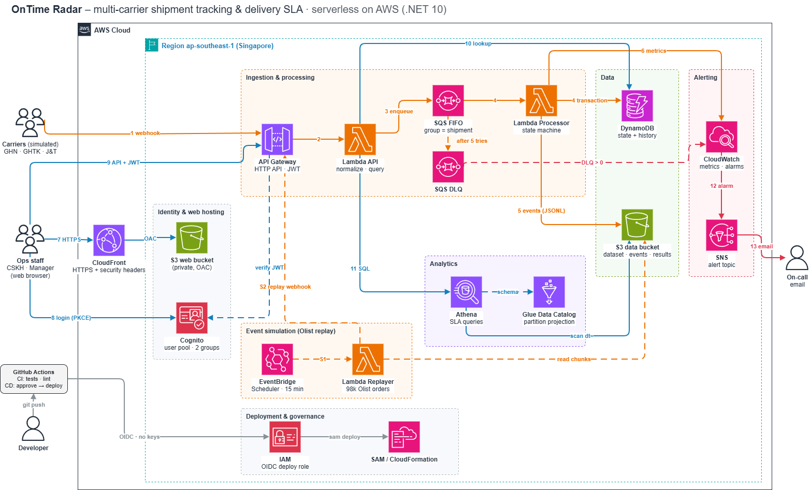

# Đề xuất dự án - OnTime Radar (Shipment SLA Service)

## 1. Tóm tắt

OnTime Radar là dịch vụ serverless trên AWS dành cho các shop bán hàng online giao hàng qua nhiều hãng vận chuyển. Hệ thống nhận webhook trạng thái từ mọi hãng, biến chúng thành một dòng thời gian đáng tin cậy cho mỗi vận đơn, gửi email cảnh báo cho nhân viên khi đơn bắt đầu giao trễ, và báo cáo tỷ lệ giao đúng hạn theo hãng và khu vực. Dashboard web có đăng nhập cung cấp đúng thứ mà CSKH và quản lý mỗi người cần.

Dự án chạy với lưu lượng thật. Một job chạy theo lịch phát lại khoảng 98.000 đơn hàng lịch sử của bộ dữ liệu thương mại điện tử công khai Olist dưới dạng webhook của hãng, mỗi 15 phút một lần, nên hệ thống được kiểm chứng với khối lượng sát thực tế chứ không chỉ vài request làm tay.

Đây là dự án thứ hai trong kỳ thực tập. Dự án đầu tiên là Job Market AWS Pipeline (pipeline dữ liệu dạng batch), được giữ lại trong mục Workshop như một case study bổ sung.

## 2. Vấn đề

Một shop online vừa và nhỏ ở Việt Nam thường dùng hai đến bốn hãng vận chuyển cùng lúc. Mỗi hãng có bộ mã trạng thái, trang tra cứu và định dạng webhook riêng. Shop phải trả giá cho điều này hằng ngày:

| Khó khăn | Hậu quả |
|---|---|
| Nhân viên phải xem nhiều trang của các hãng để theo dõi một đơn | trả lời khách chậm |
| Đơn trễ chỉ được phát hiện khi khách phàn nàn | đánh giá xấu và hoàn hàng |
| Không có số liệu đúng hạn theo hãng hay khu vực | chọn hãng theo cảm tính, không có gì để đàm phán |
| Webhook đến hai lần hoặc sai thứ tự | trạng thái đơn nhảy lùi và nhân viên mất niềm tin vào hệ thống |

## 3. Mục tiêu và tiêu chí thành công

### Mục tiêu

1. Nhận webhook từ ba hãng (GHN, GHTK, J&T; định dạng mô phỏng) và quy về một bộ tám trạng thái chung.
2. Xử lý sự kiện của từng vận đơn theo đúng thứ tự, bỏ qua bản trùng và từ chối thay đổi trạng thái vô lý.
3. Trả về toàn bộ dòng thời gian của một vận đơn trong một lần gọi API.
4. Phát hiện tỷ lệ giao trễ tăng cao và gửi email cho đội vận hành.
5. Báo cáo tỷ lệ đúng hạn theo hãng, khu vực và tuần.
6. Cung cấp dashboard web với hai vai trò: CSKH và quản lý.
7. Triển khai mọi thứ bằng code, tự động, không dùng access key dài hạn.

### Tiêu chí thành công

| Tiêu chí | Cách kiểm chứng |
|---|---|
| Trạng thái cuối không sai khi sự kiện bị trùng hoặc xáo trộn | Kiểm thử chaos trên API đã deploy: 0 sai lệch so với bộ đáp án độc lập |
| Không mất sự kiện | Replayer `Failed = 0`; dead-letter queue trống |
| Sự cố giao trễ đến được người phụ trách mà không cần ai ngồi canh màn hình | Alarm → email SNS, đã thử bằng script demo |
| Tài khoản CSKH không xem được báo cáo quản lý | Kiểm tra ma trận quyền 401/403 trên API thật |
| Chạy báo cáo tốn ít chi phí | Giới hạn 1 GB mỗi truy vấn Athena; đo tỷ lệ dùng cache |
| Hệ thống dựng lại và gỡ bỏ được từ code | Một SAM template; có hướng dẫn dọn dẹp |

## 4. Kiến trúc đề xuất

Hệ thống có ba luồng:

- **Sự kiện vào:** webhook của hãng → API Gateway → adapter trên Lambda → SQS FIFO (mỗi vận đơn một nhóm) → Lambda processor → DynamoDB (trạng thái + lịch sử trong một transaction) và event lake trên S3.
- **Dashboard cho nhân viên:** trình duyệt → CloudFront → website trên S3 private; đăng nhập bằng Cognito; API Gateway kiểm tra token; tra cứu đọc DynamoDB, còn báo cáo chạy bằng Athena trên event lake.
- **Cảnh báo:** metric từ processor → CloudWatch alarm theo tỷ lệ trễ và theo dead-letter queue → email SNS.

Triển khai: GitHub Actions chạy test, chờ tôi duyệt, nhận role tạm thời qua OIDC rồi chạy `sam deploy`.

## 5. Dịch vụ AWS và lý do lựa chọn

| Dịch vụ | Vai trò trong hệ thống | Vì sao chọn |
|---|---|---|
| Amazon API Gateway (HTTP API) | cổng vào cho webhook và dashboard | kiểm tra JWT, giới hạn tốc độ, CORS mà không cần server |
| AWS Lambda (.NET 10, arm64) | adapter, processor, replayer | trả tiền theo lượt dùng; arm64 rẻ hơn khoảng 20% |
| Amazon SQS FIFO + DLQ | giữ đúng thứ tự sự kiện của từng vận đơn | thứ tự theo message group, các nhóm chạy song song |
| Amazon DynamoDB (on-demand) | trạng thái hiện tại và lịch sử | transaction và ghi có điều kiện để đảm bảo idempotent |
| Amazon S3 | event lake, bộ dữ liệu, file website | rẻ và bền |
| AWS Glue Data Catalog + Amazon Athena | báo cáo SLA bằng SQL | không cần database server; partition projection nên không cần crawler |
| Amazon EventBridge Scheduler | chạy replayer mỗi 15 phút | lịch chạy được quản lý sẵn, đơn giản |
| Amazon Cognito | đăng nhập và phân quyền nhân viên | đăng nhập được quản lý sẵn, có nhóm, MFA tùy chọn |
| Amazon CloudFront | phục vụ dashboard qua HTTPS | giữ bucket private bằng OAC, thêm header bảo mật |
| Amazon CloudWatch + Amazon SNS | metric, log, alarm, email | có sẵn và rẻ ở quy mô này |
| AWS IAM + AWS SAM / CloudFormation | phân quyền và hạ tầng dưới dạng code | quyền tối thiểu, permissions boundary, deploy lặp lại được |

## 6. Bảo mật và vận hành

- Nhân viên đăng nhập qua Cognito (authorization code + PKCE). Gateway từ chối token sai (401), còn Lambda từ chối sai vai trò (403).
- Hãng vận chuyển xác thực bằng webhook secret. Đầu vào được kiểm tra, đầu vào sai nhận 400.
- Bucket website là private, CloudFront thêm HSTS, CSP và các header bảo mật khác, và CORS chỉ cho phép request GET từ chính domain của dashboard.
- Mọi role đều gắn permissions boundary. Việc deploy dùng OIDC có bước duyệt, không lưu access key ở bất cứ đâu.
- Giới hạn API 10 request mỗi giây cho mỗi route để bảo vệ số Lambda chạy đồng thời của tài khoản.
- Một script kiểm tra sức khỏe hằng ngày và hai alarm bao quát replayer, hàng đợi, các Lambda, event lake, API và website.

## 7. Tiến độ

Dự án bắt đầu ngày 16/11/2026 (Tuần 21). Hạn nộp Workshop là trước ngày 16/12.

| Tuần | Thời gian | Công việc | Trạng thái |
|---|---|---|---|
| 21 | 16/11 – 22/11 | Webhook, xử lý FIFO, DynamoDB, event lake S3, replayer, báo cáo Athena, Cognito, dashboard trên CloudFront, alarm, CI/CD qua OIDC, sửa các điểm từ review bảo mật | Đã xong |
| 22 | 23/11 – 27/11 | Kiểm thử chaos trên API đã deploy, ghi nhận giới hạn đã biết, thu thập bằng chứng | Đang làm |
| 23 | 30/11 – 04/12 | Báo cáo chi phí (Cost Explorer + Pricing Calculator), video demo | Dự kiến |
| 24 | 07/12 – 11/12 | Rà soát Workshop lần cuối, báo cáo và nộp bài | Dự kiến |

## 8. Ngân sách

Với replayer gửi khoảng 1.900 đơn (khoảng 9.000 sự kiện) mỗi ngày, ước tính ban đầu là **3–5 USD mỗi tháng**, chủ yếu là lượt ghi DynamoDB. Thiết kế giữ chi phí thấp nhờ dịch vụ serverless trên arm64, DynamoDB on-demand, không VPC hay NAT gateway, giới hạn 1 GB mỗi truy vấn Athena, cache báo cáo hai lớp và giữ log 14 ngày.

Đây là ước tính, không phải hóa đơn. Báo cáo cuối sẽ có số liệu đo được từ Cost Explorer và bản ước tính AWS Pricing Calculator đã lưu dựa trên số liệu đó.

## 9. Rủi ro và cách giảm thiểu

| Rủi ro | Cách giảm thiểu |
|---|---|
| Webhook trùng hoặc sai thứ tự | FIFO theo vận đơn, event ID cố định, kiểm tra version và quy tắc trạng thái |
| Một message lỗi liên tục | Partial batch failure; sau 5 lần lỗi chuyển sang DLQ và bật alarm |
| Đợt dồn tải chiếm hết Lambda (10 với tài khoản mới) | Giới hạn tốc độ API và giới hạn số luồng của processor; dự kiến xin nâng quota |
| Báo động quá nhiều | Alarm theo *tỷ lệ* trễ kéo dài, không theo số đếm thô |
| Lộ thông tin dùng để deploy | Không lưu key; OIDC gắn với ID của repository và environment đã duyệt; permissions boundary |
| Truy vấn chạy mất kiểm soát tốn tiền | Workgroup Athena giới hạn 1 GB mỗi truy vấn |
| Số liệu gây hiểu nhầm | Loại vận đơn demo và kiểm thử; ghi rõ giới hạn của các trường giả lập và dữ liệu Brazil |
| Code do AI tạo ra bị sai | Review code, hơn 200 test tự động có mutation test, và kiểm thử chaos trên hệ thống thật |

## 10. Sản phẩm bàn giao

- Mã nguồn, SAM template và workflow CI/CD trong repository `ontime-radar`.
- Sơ đồ kiến trúc (draw.io, icon AWS).
- Hệ thống đang chạy với dashboard web, alarm và phát lại dữ liệu hằng ngày.
- Workshop song ngữ gồm các bước triển khai, kiểm thử, chi phí và dọn dẹp.
- Bằng chứng: kết quả daily-check, báo cáo kiểm thử chaos và ảnh chụp màn hình.
- Video demo *(đang làm)*.
- Báo cáo chi phí *(đang làm)*.
