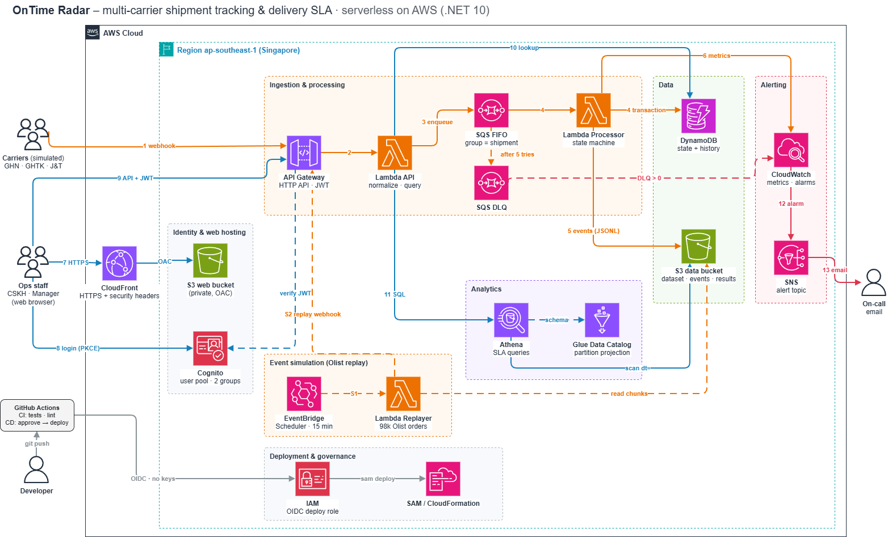

# Kiến trúc

Sơ đồ được vẽ bằng draw.io với bộ icon AWS chính thức, file gốc có thể chỉnh sửa là `docs/diagrams/architecture.drawio` trong repository. Số trên mũi tên tương ứng với các bước bên dưới. Toàn bộ hệ thống chạy ở một region là `ap-southeast-1` (Singapore).

## Luồng 1 - Nhận sự kiện từ hãng vận chuyển (bước 1-6)

1. Hãng vận chuyển (hoặc replayer) gửi webhook tới **API Gateway**. Webhook xác thực bằng header chứa secret dùng chung, không dùng Cognito.
2. **Lambda API** chọn adapter của hãng, chuyển payload về một trong tám trạng thái chung và tính `eventId` cố định từ nội dung.
3. Sự kiện được đưa vào hàng đợi **SQS FIFO**, nhóm theo vận đơn, và hãng nhận ngay phản hồi `202 Accepted`.
4. **Lambda Processor** lấy sự kiện theo từng vận đơn. Một state machine nhỏ quyết định sự kiện là `Applied`, `Stale`, `Rejected` hay `Duplicate`, và **DynamoDB** lưu trạng thái mới cùng bản ghi lịch sử trong một transaction.
5. Processor đồng thời ghi thêm sự kiện vào bucket dữ liệu **S3**, dưới `events/dt=YYYY-MM-DD/` dạng JSON lines.
6. Processor đẩy số đơn đã giao và số đơn giao trễ lên **CloudWatch**, tách theo hãng.

Message lỗi năm lần sẽ chuyển sang **dead-letter queue**, hàng đợi này có alarm riêng. Cứ mỗi 15 phút, **EventBridge Scheduler** khởi động **Lambda Replayer**. Replayer đọc các đơn Olist tiếp theo từ S3 và gửi chúng qua đúng con đường của một hãng thật (S1-S2).

## Luồng 2 - Nhân viên dùng dashboard (bước 7-11)

7. Trình duyệt tải website từ **CloudFront**. Bucket chứa web là private, chỉ CloudFront đọc được thông qua Origin Access Control.
8. Người dùng đăng nhập bằng **Cognito** (authorization code + PKCE) và nhận token ghi rõ họ thuộc nhóm nào.
9. Trình duyệt gọi API Gateway kèm token đó. Gateway từ chối token thiếu hoặc hết hạn (401), còn Lambda từ chối sai vai trò (403).
10. Khi tra cứu vận đơn, Lambda chạy một truy vấn DynamoDB trả về trạng thái và toàn bộ lịch sử.
11. Với báo cáo SLA, Lambda chạy SQL trên event lake bằng **Athena**. Schema của bảng nằm trong **Glue Data Catalog**.

## Luồng 3 - Cảnh báo (bước 12-13)

12. CloudWatch alarm bật khi tỷ lệ giao trễ từ 20% trở lên trong 2 trên 3 khung 15 phút liên tiếp, hoặc khi dead-letter queue có message.
13. **SNS** gửi email cho người trực: một lần khi sự cố bắt đầu và một lần khi sự cố đã hết.

## Triển khai

Đẩy code lên `main` sẽ chạy GitHub Actions. Test chạy trước, sau đó workflow chờ tôi duyệt, rồi nhận một IAM role tạm thời qua **OIDC** và deploy stack bằng **AWS SAM / CloudFormation**. Không có AWS access key nào được lưu trên GitHub.

## Vì sao chọn các dịch vụ này

| Nhu cầu | Lựa chọn | Lý do |
|---|---|---|
| Giữ đúng thứ tự sự kiện của một vận đơn, trong khi các vận đơn khác vẫn chạy song song | SQS FIFO, message group = vận đơn | FIFO đảm bảo thứ tự trong một nhóm, còn các nhóm được xử lý song song |
| Nhận cùng một webhook hai lần mà vẫn an toàn | `eventId` cố định + điều kiện của DynamoDB | Bản thứ hai trở thành `Duplicate` và không ghi gì |
| Trạng thái và lịch sử không bao giờ lệch nhau | Transaction DynamoDB có số version | Hai bản ghi được ghi cùng lúc, và hai luồng ghi không đè lên nhau |
| Chỉ trả tiền cho phần sử dụng | Lambda (arm64), DynamoDB on-demand, không VPC | Không có server, không NAT gateway, arm64 rẻ hơn x86 khoảng 20% |
| Phân tích SLA mà không cần database server | S3 + Athena + partition projection | Truy vấn chỉ quét những ngày cần, không cần crawler |
| Đăng nhập với hai vai trò | Cognito + JWT authorizer của API Gateway | Token sai bị chặn ở cổng trước khi Lambda chạy |
| Host website | S3 + CloudFront với OAC | Có HTTPS với chi phí gần như bằng 0, và bucket vẫn private |
| Deploy không cần key dài hạn | GitHub OIDC + bước duyệt | Secret của repository có bị lộ cũng không dùng để deploy được |

## Nhìn theo Well-Architected

- **Operational excellence:** toàn bộ stack nằm trong một SAM template. Một lệnh kiểm tra hằng ngày báo cáo 10 hạng mục sức khỏe. Việc deploy được tự động hóa và cần duyệt.
- **Security:** đăng nhập Cognito có phân quyền, webhook secret, bucket private, header bảo mật trên CloudFront, permissions boundary cho mọi role, throttling cho API, kiểm tra đầu vào và không lưu key.
- **Reliability:** thứ tự FIFO, ghi idempotent, transaction, partial batch failure kèm DLQ, và replayer không bao giờ bỏ qua đơn gửi lỗi.
- **Performance efficiency:** trong kiểm thử chaos, thời gian trung vị từ webhook đến khi trạng thái được lưu là 17 ms (p95 40 ms). Cache hai lớp giúp 79% truy vấn báo cáo không phải quét S3.
- **Cost optimization:** serverless trên arm64, DynamoDB on-demand, giới hạn 1 GB mỗi truy vấn Athena, partition projection và giữ log 14 ngày.
