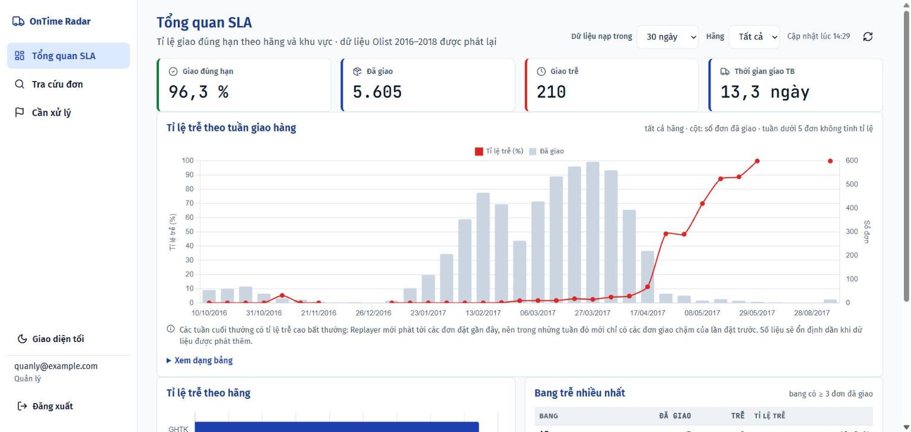
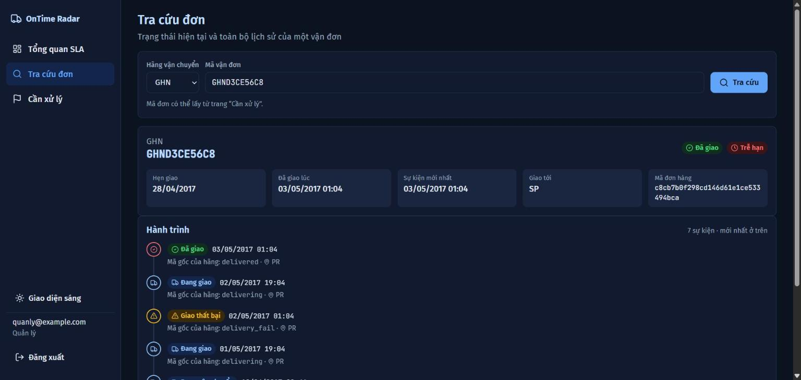
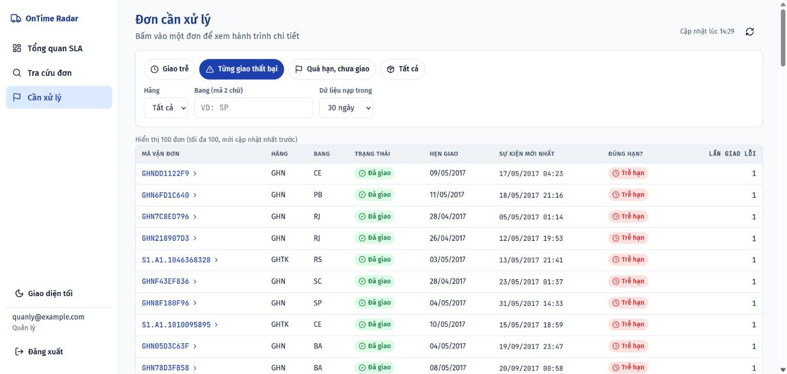

# Dashboard, đăng nhập và bảo mật

## Website

Dashboard viết bằng HTML, CSS và JavaScript thuần (khoảng 90 KB, không cần bước build), dùng Chart.js để vẽ biểu đồ. Giao diện có chế độ sáng và tối, dùng được cả trên điện thoại. Có ba trang:

| Trang | Ai được xem | Nội dung |
|---|---|---|
| Tổng quan SLA | quản lý | tỷ lệ đúng hạn, tỷ lệ trễ theo tuần, theo hãng và các khu vực trễ nhiều nhất |
| Tra cứu đơn | CSKH + quản lý | trạng thái hiện tại và toàn bộ dòng thời gian của một vận đơn |
| Cần xử lý | CSKH + quản lý | đơn giao trễ, từng giao thất bại và quá hạn, lọc theo hãng và khu vực |

*Trang Tổng quan SLA, ngày 19/11/2026. Email đăng nhập đã được thay bằng địa chỉ ví dụ.*

*Tra cứu một vận đơn. Các sự kiện bị chặn được hiển thị kèm lý do vì sao chúng không làm đổi trạng thái.*

*Danh sách "Cần xử lý". Bấm vào một dòng sẽ mở dòng thời gian của vận đơn đó.*

## Đăng nhập và vai trò

Nhân viên đăng nhập qua trang có sẵn của Cognito, dùng luồng authorization code kèm PKCE, nên trình duyệt không giữ client secret nào. Token chỉ được lưu trong tab trình duyệt (`sessionStorage`) và hết hạn sau một giờ. Xác thực đa yếu tố là tùy chọn, mỗi người tự bật.

| Yêu cầu | Không có token | Có token, chưa có nhóm | `cskh` | `manager` |
|---|---|---|---|---|
| `GET /shipments...` | 401 | 403 | ✅ | ✅ |
| `GET /sla/summary`, `GET /sla/trend` | 401 | 403 | 403 | ✅ |

Việc kiểm tra diễn ra ở hai lớp:

1. JWT authorizer của API Gateway chặn token thiếu, không hợp lệ hoặc hết hạn bằng mã **401**, trước khi Lambda nào chạy.
2. API Gateway không kiểm tra được nhóm Cognito, nên Lambda làm việc này và trả **403** khi sai vai trò. Có unit test báo lỗi nếu bất kỳ route `GET` nào ngoài `/health` thiếu bước kiểm tra vai trò.

Webhook của hãng không dùng Cognito. Webhook phải gửi header `X-Webhook-Secret`.

## Bảo vệ website

- File web nằm trong một bucket S3 private riêng, tách khỏi dữ liệu đơn hàng. Chỉ CloudFront đọc được bucket này, thông qua Origin Access Control.
- CloudFront bắt buộc HTTPS và thêm các header bảo mật: Content-Security-Policy có `frame-ancestors 'none'`, HSTS, `X-Frame-Options`, `X-Content-Type-Options: nosniff` và `Referrer-Policy: no-referrer`.
- Chart.js được tải kèm Subresource Integrity, và mọi giá trị từ API đều được escape trước khi hiển thị.
- Cấu hình CORS của API và URL callback của Cognito chỉ chấp nhận domain của CloudFront và `http://localhost:5500` để thử trên máy.

## Bảo vệ API và tài khoản AWS

- **Giới hạn tốc độ:** mỗi route nhận 10 request mỗi giây, đỉnh 20. Request vượt mức nhận 429 ngay ở cổng, nên một đợt dồn request không thể chiếm hết 10 Lambda chạy đồng thời của một tài khoản mới. Replayer gửi lại khi gặp 429 một cách an toàn, vì cùng payload sẽ cho cùng `eventId`.
- **Kiểm tra đầu vào:** mã vận đơn, tham số truy vấn và cấu trúc payload đều được kiểm tra, đầu vào sai trả về 400.
- **Quyền tối thiểu:** mỗi role của Lambda chỉ được các thao tác cần thiết trên tài nguyên của stack này.
- **Permissions boundary:** mọi role trong stack đều gắn boundary `shipment-sla-boundary`. Role deploy chỉ được tạo hoặc sửa role khi có gắn boundary đó, và bị cấm tường minh việc gỡ hay sửa boundary. Kể cả khi token deploy bị đánh cắp cũng không tạo được role quản trị.
- **Không có key dài hạn:** GitHub Actions nhận role tạm thời qua OIDC. Role chỉ tin đúng repository này, nhận diện bằng ID số cố định của chủ sở hữu và repository trên GitHub, và chỉ tin environment `production` đã được duyệt.

> 📷 *Ảnh cần bổ sung: response header trong công cụ dành cho nhà phát triển của trình duyệt, và thiết lập "Block all public access" của bucket web.*
