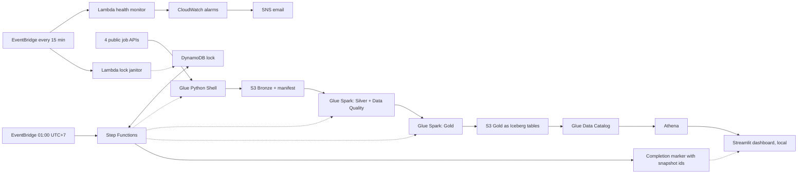

# Architecture and Design

*Architecture as deployed after 23 November 2026, drawn in draw.io with AWS icons. Source: `docs/diagrams/architecture.drawio` in the repository.*

## How a Run Flows

A run goes through five stages:

1. At 01:00 Vietnam time, EventBridge starts one Step Functions execution. The first thing it does is take a lock in DynamoDB, so two runs can never write at the same time.
2. A Glue Python Shell job calls the 36 job boards (five at a time), saves each raw answer to the Bronze area of S3, and writes a manifest last. Nothing later reads a file that the manifest does not list.
3. A Glue Spark job turns Bronze into Silver. It works out which postings are new, still open, or closed, and stops the run if the Glue Data Quality rules fail.
4. A second Spark job builds three Gold tables and commits each one as an Apache Iceberg table. Step Functions then writes a completion marker that records the exact Iceberg snapshot of every table.
5. Every 15 minutes, a health-monitor Lambda checks that the published data is fresh and complete, and alarms through SNS if it is not. A second Lambda, the lock janitor, frees a lock that an aborted run left behind.

## Why Each Service

| Need | Service I chose | Why not something else |
|---|---|---|
| Store raw and processed data cheaply | Amazon S3 | One run per day does not justify a database that runs all the time |
| Call HTTP APIs | Glue Python Shell | The work is small. A Spark cluster would cost more and start slower |
| Join and reconcile thousands of rows | Glue Spark + Glue Data Quality | Managed Spark, with quality rules built in |
| Run stages in order, wait, and clean up on failure | Step Functions | A plain cron cannot release a lock or check results between stages |
| Make sure only one writer runs | DynamoDB conditional write | A lock with a timer could expire while Glue is still writing |
| Make each day's Gold change all-or-nothing | Apache Iceberg | Each table commit is atomic, and readers can pin an exact version |
| Run SQL without a server | Athena | Query volume is far too low for Redshift |
| Watch the pipeline from outside | Lambda + CloudWatch + SNS | The monitor still works when the pipeline itself is broken |
| Describe all of the above | Terraform | Every resource and permission is reviewed in a plan before it changes |

## Well-Architected View

- **Operational excellence:** everything is in Terraform. Six CloudWatch alarms cover failed, timed-out, and aborted runs, unhealthy data, low source coverage, and janitor errors. Runbooks describe recovery.
- **Security:** each stage has its own IAM role, the dashboard can only read, buckets are private and accept HTTPS only, and no access keys are stored. Checkov scans the Terraform code on every pull request.
- **Reliability:** the manifest is the commit point, the writer lock is released only on evidence, failed or truncated boards never close postings, and Gold changes are atomic.
- **Performance efficiency:** API calls run in parallel with a bounded queue that fits the 1 GB Python Shell. Spark runs only where data is joined. Athena reads one pinned snapshot, about 1 MiB per dashboard query.
- **Cost optimization:** the pipeline runs once a day, uses the smallest Glue workers, sets lifecycle rules on every bucket, and caps each Athena query at 10 GiB. Removing the Glue crawler cut about 44% of the Glue cost per run.

## Known Trade-offs

- The three Gold tables commit one after another, not in a single transaction. The completion marker solves this for readers: it names one consistent set of snapshot ids.
- The dashboard runs on my own machine. It is a viewer for the published data, not a public website.
