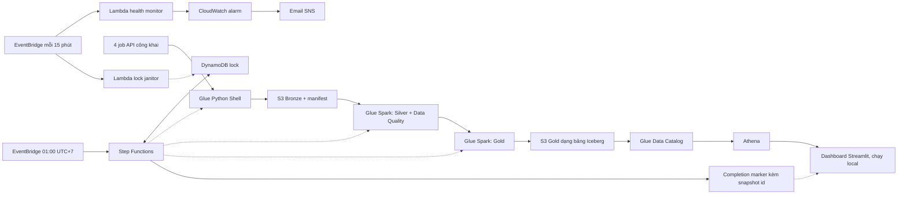

# Kiến trúc và thiết kế

*Kiến trúc đang chạy sau ngày 23/11/2026, vẽ bằng draw.io với icon AWS. File gốc: `docs/diagrams/architecture.drawio` trong repository.*

## Một lượt chạy diễn ra thế nào

Một lượt chạy gồm năm giai đoạn:

1. Lúc 01:00 giờ Việt Nam, EventBridge khởi động một execution của Step Functions. Việc đầu tiên là lấy lock trong DynamoDB, để không bao giờ có hai lượt cùng ghi dữ liệu.
2. Một Glue Python Shell job gọi 36 board tuyển dụng (năm board cùng lúc), lưu từng phản hồi thô vào vùng Bronze trên S3 và ghi manifest sau cùng. Các bước sau không đọc file nào không có trong manifest.
3. Một Glue Spark job biến Bronze thành Silver. Nó xác định tin nào mới, còn mở hay đã đóng, và dừng lượt chạy nếu các quy tắc Glue Data Quality không đạt.
4. Một Spark job thứ hai tạo ba bảng Gold và commit mỗi bảng dưới dạng bảng Apache Iceberg. Sau đó Step Functions ghi completion marker, lưu đúng snapshot Iceberg của từng bảng.
5. Mỗi 15 phút, Lambda health monitor kiểm tra dữ liệu đã publish còn mới và đầy đủ không, nếu không thì cảnh báo qua SNS. Một Lambda thứ hai là lock janitor gỡ lock do lượt chạy bị hủy để lại.

## Vì sao chọn từng dịch vụ

| Nhu cầu | Dịch vụ tôi chọn | Vì sao không chọn cách khác |
|---|---|---|
| Lưu dữ liệu thô và đã xử lý với chi phí thấp | Amazon S3 | Mỗi ngày chạy một lần, không đáng dùng database chạy suốt ngày |
| Gọi HTTP API | Glue Python Shell | Khối lượng nhỏ; cluster Spark tốn tiền hơn và khởi động chậm hơn |
| Ghép và đối soát hàng nghìn dòng | Glue Spark + Glue Data Quality | Spark được quản lý sẵn, có sẵn quy tắc chất lượng |
| Chạy các bước theo thứ tự, chờ, dọn dẹp khi lỗi | Step Functions | Cron đơn thuần không nhả được lock hay kiểm tra kết quả giữa các bước |
| Đảm bảo chỉ một lượt ghi | Ghi có điều kiện trên DynamoDB | Lock có hẹn giờ có thể hết hạn khi Glue vẫn đang ghi |
| Mỗi ngày Gold thay đổi trọn vẹn hoặc không đổi | Apache Iceberg | Mỗi lần commit một bảng là atomic, và người đọc ghim được đúng phiên bản |
| Chạy SQL không cần server | Athena | Lượng truy vấn quá nhỏ để dùng Redshift |
| Giám sát pipeline từ bên ngoài | Lambda + CloudWatch + SNS | Bộ giám sát vẫn hoạt động khi chính pipeline bị hỏng |
| Mô tả toàn bộ hạ tầng trên | Terraform | Mọi resource và quyền đều được review qua plan trước khi thay đổi |

## Nhìn theo Well-Architected

- **Operational excellence:** mọi thứ nằm trong Terraform. Sáu CloudWatch alarm theo dõi lượt chạy lỗi, timeout, bị hủy, dữ liệu không ổn, độ phủ nguồn thấp và lỗi của janitor. Có runbook hướng dẫn phục hồi.
- **Security:** mỗi bước có IAM role riêng, dashboard chỉ được đọc, bucket private và chỉ nhận HTTPS, không lưu access key. Checkov quét code Terraform ở mỗi pull request.
- **Reliability:** manifest là điểm commit, lock chỉ được nhả khi có bằng chứng, board lỗi hoặc thiếu trang không bao giờ làm đóng tin, và thay đổi trên Gold là atomic.
- **Performance efficiency:** gọi API song song với hàng đợi có giới hạn, vừa với 1 GB RAM của Python Shell. Spark chỉ dùng ở nơi cần ghép dữ liệu. Athena đọc đúng một snapshot đã ghim, khoảng 1 MiB cho mỗi truy vấn của dashboard.
- **Cost optimization:** chạy mỗi ngày một lần, dùng Glue worker nhỏ nhất, đặt lifecycle cho mọi bucket, giới hạn 10 GiB mỗi truy vấn Athena. Bỏ Glue crawler giúp giảm khoảng 44% chi phí Glue mỗi lượt.

## Các đánh đổi đã biết

- Ba bảng Gold được commit lần lượt, không nằm trong một transaction chung. Completion marker giải quyết việc này cho phía đọc: nó ghi một bộ snapshot id nhất quán.
- Dashboard chạy trên máy của tôi. Đây là công cụ xem dữ liệu đã publish, không phải website công khai.
